# Cutely Ask Me - Product and UX Review (November 2026)

Reviewed on November 2, 2026 against `main` at `0ef9ecb` (Next.js 16.4.3).
Every screen below was clicked through in a local production build (`next build` + `next start`) with a throwaway local SQLite database, the Clerk development instance, real Google Maps/Places/Gemini keys, and email sending disabled.
The public pages were also checked on the live deployment at <https://cutelyaskme.vercel.app>.
Screenshots live in [`docs/review-2026-11/`](./review-2026-11/) at desktop (1440x900) and phone (390x844).
No app code was changed for this review.

## Contents

1. [What it is](#what-it-is)
2. [Who it is for](#who-it-is-for)
3. [Current state](#current-state)
4. [Flow-by-flow UX walkthrough](#flow-by-flow-ux-walkthrough)
5. [UI polish list](#ui-polish-list)
6. [Engineering health](#engineering-health)
7. [Market and differentiation](#market-and-differentiation)
8. [Verdict](#verdict)
9. [Prioritized next steps](#prioritized-next-steps)

## What it is

Cutely Ask Me is a two-sided "will you go on a date with me?" web app.
The sender signs in, types the other person's name, email and rough area, and gets a personal invite link.
The recipient opens the link without an account, sees a playful ask with a "No" button that dodges away, says yes, and walks a six-step wizard: day, time, two activities, food, dress vibe, then "Lock it in".
The sender then turns those choices into a real itinerary: picks an actual venue for each stop (Google Places, OpenStreetMap, or a dropped pin), reorders stops with a sunset strip, sets durations, sees routed travel legs on a Google map, exports to a calendar, and finally either shares the plan or keeps it a surprise.
After the date both people can rate the night, give each venue a thumbs verdict, and write notes that Gemini turns into a short poem on an animated keepsake card with photos and music.

The data model is small and sensible: `invites` (token, sender, recipient name/email, location, status), `date_plans` (the recipient's choices, chosen venues, itinerary, timezone, lifecycle timestamps `confirmed_at` / `canceled_at`), plus `ratings`, `venue_verdicts`, `date_memories`, `user_settings`, saved addresses, push subscriptions, a notification outbox, and API usage counters.
Auth is Clerk (Google OAuth plus email and password); recipients use a signed, HTTP-only per-plan capability cookie instead of an account.
Data is Turso (libSQL) through Drizzle, email is Resend, and hosting is Vercel with a Vercel Queue plus daily cron for notification retries.

## Who it is for

The primary user is someone who wants to ask a person out, or plan a date night with a partner, in a way that feels thoughtful and a little bit cute.
The secondary user is the recipient, who should get a delightful, zero-friction experience from a single link on their phone.
In practice the sender side today is built for a power user (the owner): it exposes API quotas, search radius bounds, wheel-zoom modes and per-leg drive/walk toggles.
The product sits between two audiences that want different things: young singles asking someone out (playful, one-shot, viral) and couples planning recurring date nights (practical, repeat use, memory keeping).
The keepsake and "Places you loved" features point at couples; the dodging "No" button points at first asks.

## Current state

### Deployment

- Production is live on Vercel at <https://cutelyaskme.vercel.app> (HTTP 200), with the older `date-planner-mini-site.vercel.app` alias still answering.
- The intended domain `cutelyask.me` is not owned yet, per [`docs/OUTSTANDING.md`](./OUTSTANDING.md) and [`docs/LAUNCH.md`](./LAUNCH.md).
- Clerk runs on the development instance in production, so the sign-in widget says "Development mode".
- Email sends from Resend's shared `onboarding@resend.dev`, which only delivers to the Resend account owner, so real recipients never receive the invite email.
- `metadataBase` in `src/app/layout.tsx` still points at `date-planner-mini-site.vercel.app`, so link previews advertise the old URL.

### Works

- The full loop works end to end locally: create invite, recipient wizard, lock in, sender venue search and selection, travel legs, calendar export, share, recipient plan view, post-date rating, verdicts, Gemini poem and keepsake card.
- The recipient wizard is genuinely charming, mobile-first and fast, with good copy and illustration.
- Security fundamentals are strong: plan access is capability-scoped, there is a strict nonce-based CSP, HSTS, `X-Frame-Options: DENY`, rate limiting, and service budgets.
- Unit tests (321), lint, typecheck, build and the Playwright public smoke suite (15 tests across Chromium desktop, Chromium mobile and WebKit mobile) all pass.

### Broken

- The production sign-in page renders completely unstyled because the CSP blocks Clerk's injected styles (see S1 below).
- Every `<button>` in the app ignores its Tailwind font size and weight because of an unlayered global rule (see S2 below).
- Email sign-up is a dead end: "Don't have an account? Sign up" links back to the same sign-in page.
- Senders can share a plan with only one of three stops filled in, and after sharing the planner still shows the full editing UI, whose saves then fail with a generic "Couldn't save. Try again."

### Unfinished

- Custom domain, Resend domain verification, and the Clerk production instance are all still owner tasks.
- There is no marketing or explanation page: the home page is one heading ("Date Night"), one sentence and two buttons.
- The product name is inconsistent: "Cutely Ask" (tab title, Clerk), "Date Night" (home page, emails), "cutelyask.me" (docs), and "Cutely Ask Me" (repo).
- There is no CI at all, and five Dependabot pull requests are open.

## Flow-by-flow UX walkthrough

Severity scale: **S1** blocks or breaks a core flow for real users, **S2** a significant problem a real user will hit, **S3** polish or a minor annoyance.

### 1. Landing page (`/`)

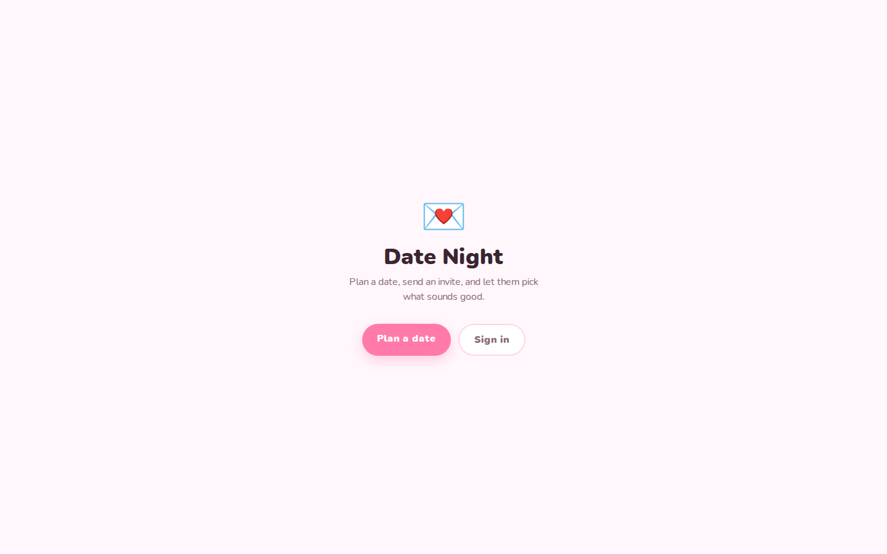

| # | Sev | Problem | Fix |
|---|---|---|---|
| 1.1 | S2 | The page explains nothing: no example, no screenshot of the ask, no "how it works", no reason to sign up. A visitor from a waitlist link would bounce. | Build a real landing page: hero with a live mini demo of the ask (the dodging No is the hook), three-step "ask, they pick, you plan", a keepsake preview, and one CTA. |
| 1.2 | S2 | Brand is "Date Night" here but "Cutely Ask" in the title and sign-in widget. | Pick one name (recommend "Cutely Ask Me" to match the domain plan) and apply it everywhere, including emails and the PWA manifest. |
| 1.3 | S3 | "Plan a date" and "Sign in" both lead to sign-in for logged-out users, so two buttons do the same thing. | Make the primary CTA "Ask someone out" and route it to a short explainer or straight into sign-up; demote "Sign in" to a header link. |

### 2. Sign in and sign up (`/login`)

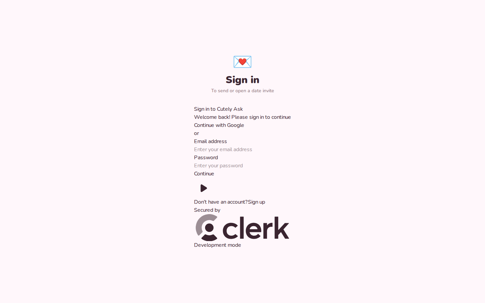

| # | Sev | Problem | Fix |
|---|---|---|---|
| 2.1 | S1 | On production and locally, the Clerk widget renders as raw unstyled text and a giant Clerk logo. The CSP `style-src` has a nonce but Clerk's runtime `<style>` tags do not get it. The browser logs 13 CSP violations per page load. | Pass the request nonce to Clerk (`<ClerkProvider nonce={nonce}>` read from the `X-Nonce` header set in `src/proxy.ts`, or use `clerkMiddleware`'s built-in strict CSP support) and add a Playwright test that loads `/login` with ClerkProvider enabled and asserts zero CSP violations. |
| 2.2 | S1 | "Don't have an account? Sign up" points to `/login`, which renders `<SignIn>` again, so email-and-password users can never create an account. Only Google works. | Add a `/sign-up/[[...sign-up]]` route with `<SignUp>` and set `NEXT_PUBLIC_CLERK_SIGN_UP_URL=/sign-up`, or disable password sign-in in Clerk if Google-only is the decision (as `docs/PRODUCT_FLOW.md` says). |
| 2.3 | S2 | Production shows Clerk's "Development mode" badge. | Complete LAUNCH.md step 3 (Clerk production instance). |
| 2.4 | S3 | Subtitle "To send or open a date invite" is wrong: recipients never need to sign in to open an invite. | Change to "Sign in to send a date invite". |
| 2.5 | S3 | Three different return parameters exist: the login page reads `returnTo`, `SummaryStep` sends `?redirect=`, and the memory page sends `?redirect_url=`. The `redirect` one is silently ignored. | Standardize on Clerk's `redirect_url` (validated) and delete the other two. |

### 3. Send an invite (`/send`)

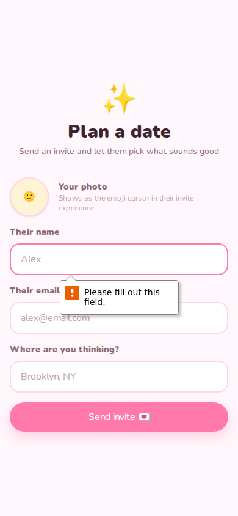
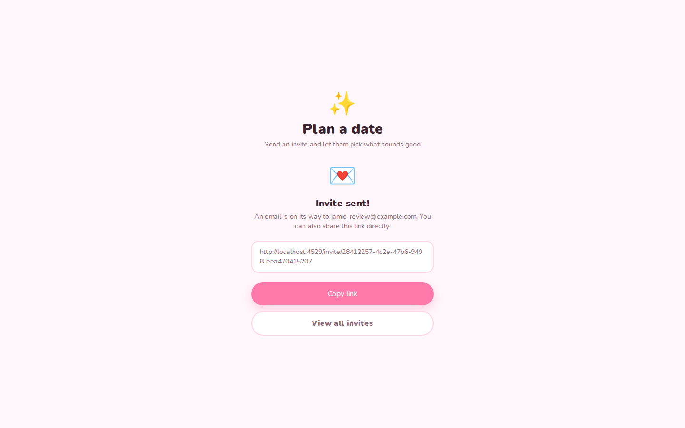

| # | Sev | Problem | Fix |
|---|---|---|---|
| 3.1 | S1 | "Invite sent! An email is on its way to ..." is shown even though production email cannot reach anyone but the owner, and it is shown regardless of delivery outcome. | Verify the sending domain first; until then, change the success copy to lead with "Copy the link and send it yourself" and treat email as a bonus. |
| 3.2 | S2 | Form labels are not associated with inputs (`<label>` has no `htmlFor`, inputs have no `id`), so screen readers announce the placeholder "Alex" as the field name. | Add `id`/`htmlFor` pairs, or wrap inputs in their labels. |
| 3.3 | S2 | Validation relies only on native browser bubbles; there is no inline error styling. | Add inline errors under fields with `aria-describedby`. |
| 3.4 | S3 | The success state keeps the "Plan a date" page header above "Invite sent!", so the page has two headings. | Replace the header with the success state, and add a preview link ("See what they'll see"). |
| 3.5 | S3 | "Your photo" says it "Shows as the emoji cursor in their invite experience", which is hard to understand. | "Your face pops up next to theirs while they plan." |

### 4. The ask (`/invite/[token]`)

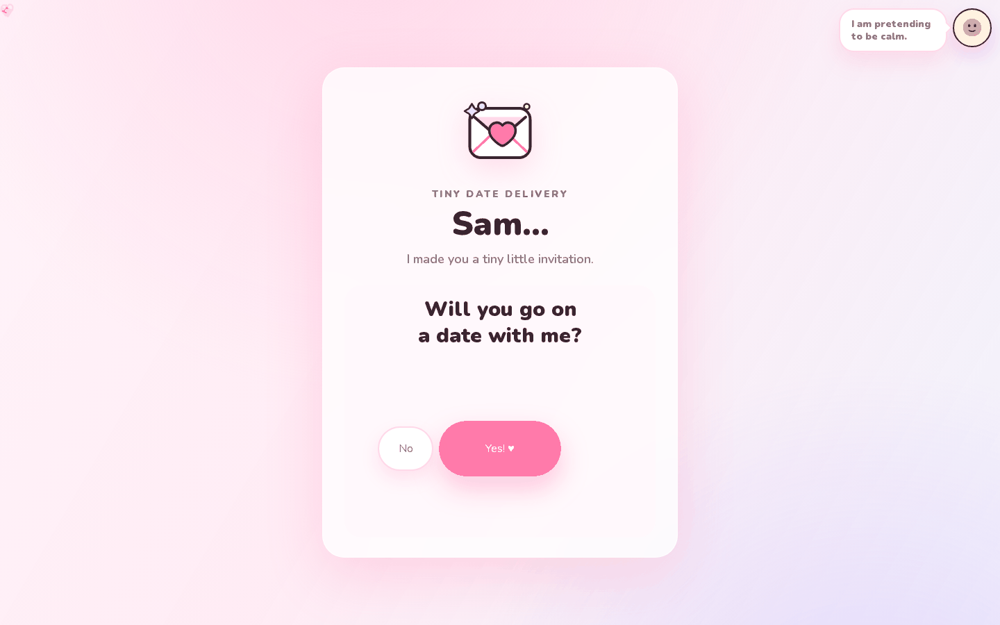
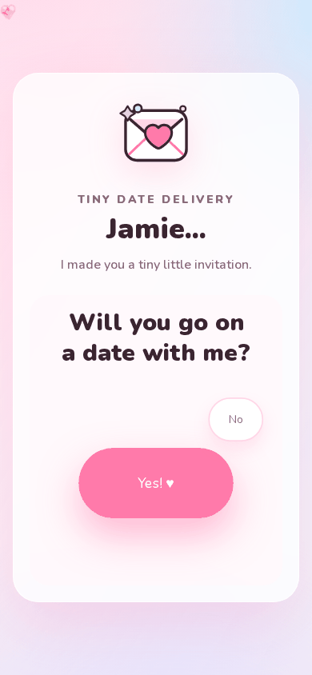

| # | Sev | Problem | Fix |
|---|---|---|---|
| 4.1 | S2 | The "Yes! ♥" button is meant to be `text-2xl font-black` but renders small and thin because of the global `button { font: inherit; }` rule in `globals.css`, which is unlayered and therefore beats Tailwind v4's layered utilities. This affects every button in the app (compare "Copy link" vs "Preview" on the dashboard). | Move the rule into `@layer base` or delete it (Tailwind preflight already sets `font: inherit` on buttons). |
| 4.2 | S2 | The floating hearts are all piled into the top-left corner (visible as a clipped heart at 0,0) because their `left`/`top` come from server-rendered inline `style` attributes, which the CSP blocks. Twenty-eight components use `style={...}`. | Add `style-src-attr 'unsafe-inline'` (low risk, style attributes cannot run script) or move positions to classes or CSS variables set from JS after hydration. |
| 4.3 | S2 | White text on `#ff7aaa` is 2.4:1 contrast, below the WCAG 4.5:1 minimum, on the most important button. | Darken the primary to about `#d9467f` for text buttons, or use dark text on the pink. |
| 4.4 | S3 | The No/Yes pair sits off-centre in the card on desktop, and the "I am pretending to be calm" avatar bubble floats far away in the corner of a 1440px screen. | Centre the button group, and anchor the avatar bubble to the card on wide screens. |
| 4.5 | S3 | There is no way to say no. It is a joke, but some recipients will find it pushy, and nothing tells the sender if the person bailed. | Keep the dodge for a few tries, then reveal a gentle "Maybe another time" that politely notifies the sender. |

### 5. Recipient wizard

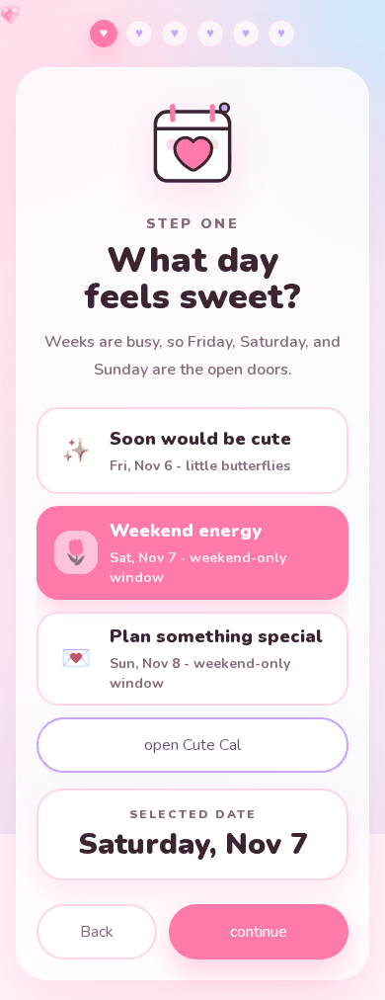
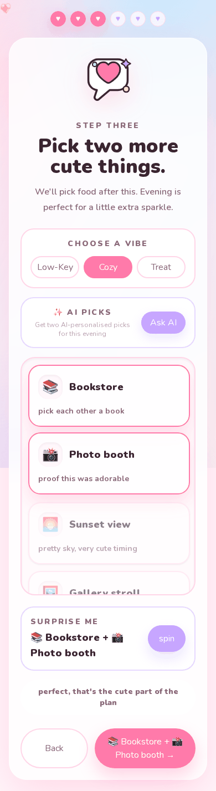
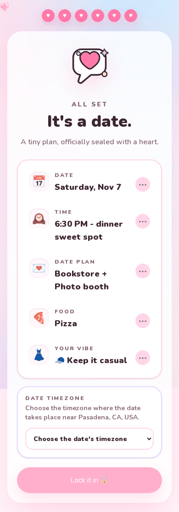

| # | Sev | Problem | Fix |
|---|---|---|---|
| 5.1 | S1 | Before "Lock it in" the recipient must choose the date's timezone from a 420-entry IANA list that starts empty, and the button stays disabled until they do. This is the single biggest friction point in the funnel, and most people have no idea what "America/Los_Angeles" means. | Derive the timezone from the invite location when the sender creates it (the geocode is already done), fall back to the browser's `Intl` zone, and show it read-only with a small "change" link. |
| 5.2 | S2 | The summary heading says "It's a date." before anything is locked, and the confirmation screen then says "It's a date! 🎉" again. | Summary: "Look good?" with the lock button; keep the celebration for after. |
| 5.3 | S2 | Only Friday, Saturday and Sunday are offered as quick picks, with copy that says weekdays are closed. | Let the sender choose allowed days, or offer weekdays behind Cute Cal without saying they are off-limits. |
| 5.4 | S3 | Button casing is inconsistent: "continue", "spin", "add the fun", "open Cute Cal" next to "Back", "Almost there →" and "Lock it in". | Pick sentence case for all actions. |
| 5.5 | S3 | The six progress hearts have no labels or accessible names, so you cannot tell which step you are on with a screen reader. | Add `aria-label="Step 3 of 6: activities"` and `aria-current`. |
| 5.6 | S3 | On desktop, the person-cursor avatar sits on top of the selected card's text after a click. | Offset the avatar from the pointer or fade it while hovering cards. |
| 5.7 | S3 | Name-only links like `/invite/Sam` run the whole wizard and end in "Send me the plan / Copy plan" with nothing saved, which makes a convincing but dead-end demo. | Label this mode as a demo ("This is a preview - ask for real") and link to sign-up. It is great landing-page material. |

### 6. After "Lock it in"

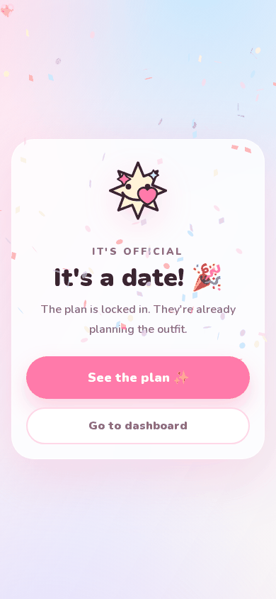
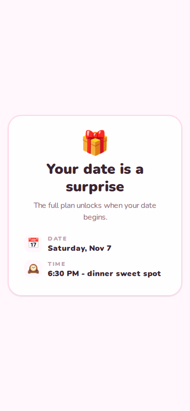

| # | Sev | Problem | Fix |
|---|---|---|---|
| 6.1 | S2 | "Go to dashboard" is offered to an anonymous recipient, which just bounces them to sign-in. | Replace with "Get notified when it's planned" (email opt-in or sign in with the invited email). |
| 6.2 | S2 | "See the plan" immediately shows "Your date is a surprise. The full plan unlocks when your date begins", even though the sender has not chosen surprise mode yet. The recipient also cannot see the activities and food they just picked. | Show "Waiting for {sender} to pick the spots" with the recipient's own choices, and only say "surprise" once the sender chooses it. |

### 7. Sender dashboard (`/dashboard`)

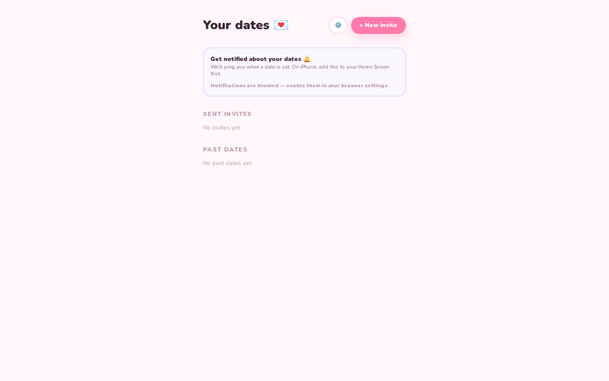
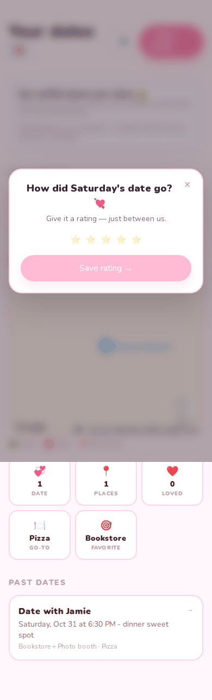

| # | Sev | Problem | Fix |
|---|---|---|---|
| 7.1 | S2 | The empty state is two grey lines ("No invites yet.", "No past dates yet."). | Big friendly empty state with an illustration and a "Ask someone out" CTA. |
| 7.2 | S3 | The notification card dominates the page before the user has done anything. | Show it after the first invite is sent. |
| 7.3 | S3 | The settings gear is an emoji-only button; it has an `aria-label` but low contrast and no visible text. | Fine for now; consider a labeled header menu once there is a profile. |
| 7.4 | S3 | On phone, the "Your dates 💌" title wraps the emoji to a second line next to the buttons. | Shrink the title on small screens or move actions below it. |

### 8. Sender planner (`/plan/[id]`)

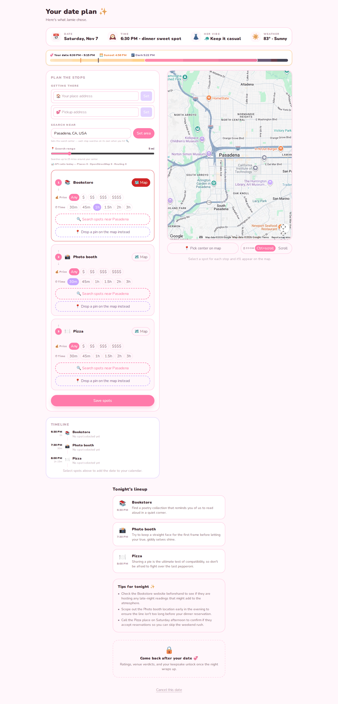
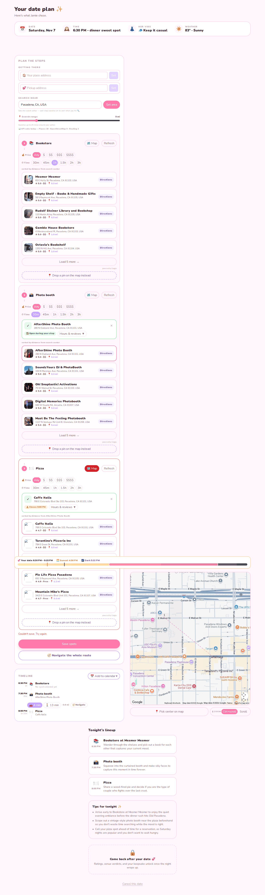
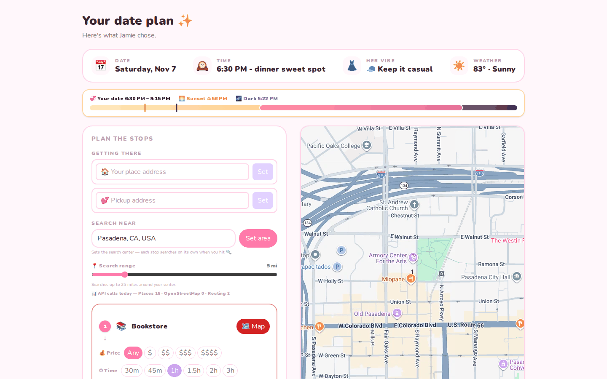

| # | Sev | Problem | Fix |
|---|---|---|---|
| 8.1 | S1 | "Share plan" / "Surprise her" appears after any save, even with only one of three stops filled in. In the walkthrough a plan was shared with two empty stops, and the recipient's view then showed "Photo booth" and "Pizza" with no place, address or directions. | Require every stop to have a venue (or an explicit "we'll decide on the night") before sharing, and show a checklist of what is missing. |
| 8.2 | S1 | After sharing, reloading the planner still shows the full editing UI (search, price filters, "Save spots"), with no "Shared on ..." status. Saving then returns HTTP 409 and the UI says only "Couldn't save. Try again." | Render a read-only "Shared" state with the frozen plan, calendar export and a "Cancel date" action; surface the server message ("This date was already shared") when a 409 happens. |
| 8.3 | S1 | Google Places photos, details and searches have app-wide daily caps of 30, 30 and 150 (`lib/api-limits.ts`). Two short planning sessions in this review (16 Places calls in total) used up the entire daily photo budget, and the photo API began returning 429. With more than a handful of users a day, venue search stops working for everyone. | Lazy-load photos only for the selected venue, cache Places responses per place id, and add per-user daily quotas on top of the global cap; raise the Cloud Console caps once billing alerts exist. |
| 8.4 | S2 | The planner is a dense power-user tool: API call counters, search radius slider bounds, wheel-zoom modes, start and pickup addresses, price and time chips on every stop. A first-time sender sees about 60 buttons above the fold. | Default to a guided "one stop at a time" view with a recommended pick per stop, and tuck advanced controls behind "More options". Remove API counters from the user UI. |
| 8.5 | S2 | Every search result showed "★ 5.0 · $$", which looks like placeholder data and undermines trust. | Check the Places field mask and price mapping; show review counts and hide unknown price levels. |
| 8.6 | S2 | Copy assumes a female recipient: "Her vibe", "Send her a notification", "Surprise her 🎁", "The way she laughed..." placeholder, and `"her"` as a name fallback. | Use the recipient's name or neutral "them", or ask pronouns at invite time. |
| 8.7 | S3 | Reorder arrows (↑ ↓) are tiny, float above and below the stop number, and have no accessible names. | Use labeled icon buttons ("Move Bookstore up") or drag handles. |
| 8.8 | S3 | On desktop the bottom half switches from a two-column layout to a narrow centred column, leaving the map column empty beside the stops and the lineup orphaned below. | Keep the map sticky in the right column for the full height and put the lineup in the left column. |
| 8.9 | S3 | Gemini "Tips for tonight" are generic when venues are missing ("Call the Pizza place") and still say "tonight" on past dates. | Regenerate tips only after venues are chosen, and switch to past tense after the date. |

### 9. Shared plan (recipient view)

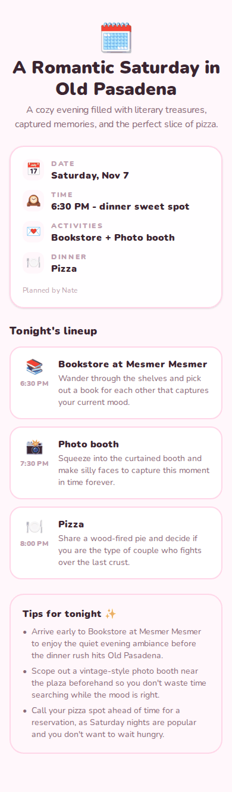

| # | Sev | Problem | Fix |
|---|---|---|---|
| 9.1 | S2 | The recipient's view lists stops but no addresses, no map and no "add to calendar", so they cannot actually get to the date. | Show the map, addresses, "Navigate" links and an "Add to calendar" button on the recipient view (the sender already has all of these). |
| 9.2 | S3 | The Gemini title "A Romantic Saturday in Old Pasadena" is lovely; keep it, but the dress vibe the recipient chose is missing from their own view. | Add the dress vibe row. |

### 10. After the date: rating, verdicts, keepsake

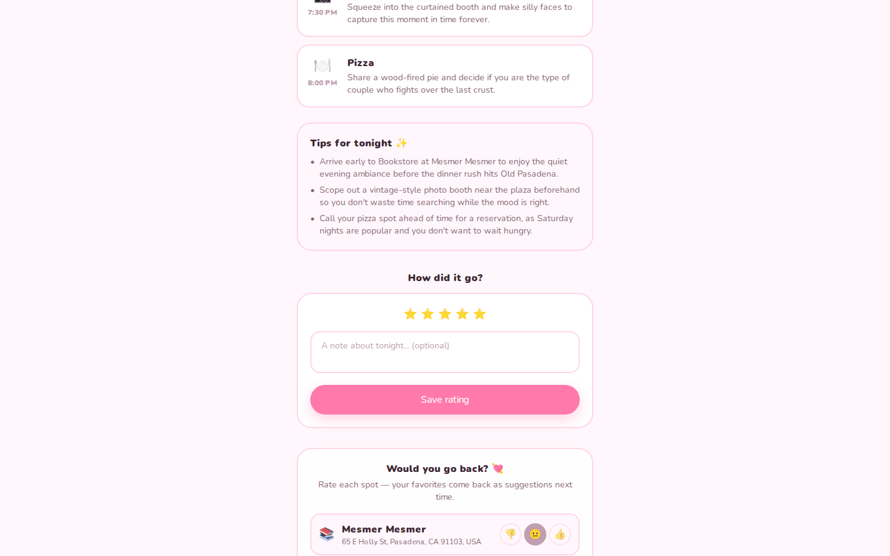
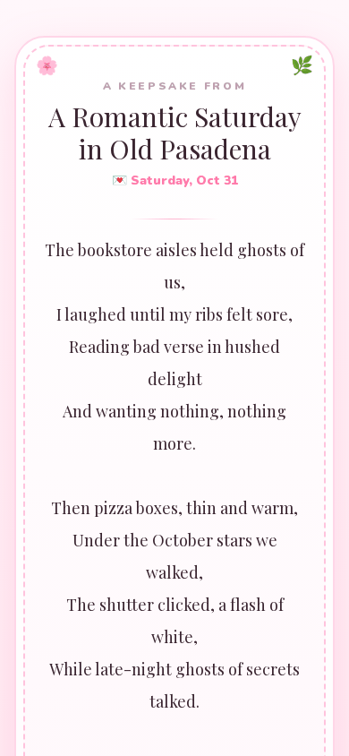

| # | Sev | Problem | Fix |
|---|---|---|---|
| 10.1 | S3 | The keepsake card is the most share-worthy screen in the product, and the Gemini poem was good, but long lines wrap mid-verse on phone because the poem is centred at a large size. | Left-align or reduce poem size on phone, and keep one verse line per visual line. |
| 10.2 | S3 | Verdict buttons are emoji-only (👎 😐 👍) without visible labels. | Add `aria-label`s and small captions ("Nope", "Meh", "Again!"). |
| 10.3 | S3 | The dashboard rating modal appears on top of everything on the first visit after a date, with a blurred page behind it. | Fine as a nudge; make sure it is dismissible with Escape and focus-trapped. |

### 11. Settings (`/settings`)

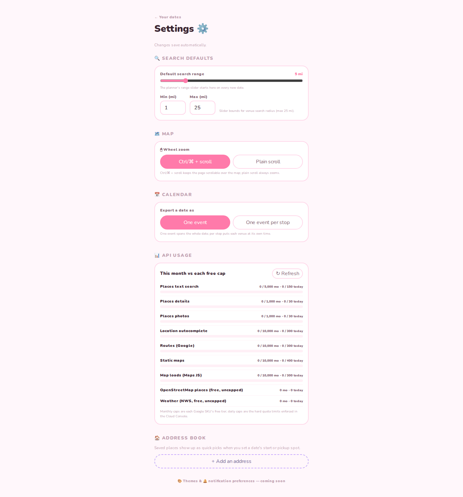

| # | Sev | Problem | Fix |
|---|---|---|---|
| 11.1 | S2 | "API usage" shows Google SKU quotas and Cloud Console caps to every signed-in user. This is an operator dashboard, not a user setting, and it reveals the app's capacity limits. | Move it to an owner-only admin page gated by Clerk role or user id. |
| 11.2 | S3 | The range slider track renders in the browser's default dark grey, off-palette. | Style the track with `accent-color` and a custom track. |
| 11.3 | S3 | "Themes & notification preferences - coming soon" footer. | Remove until it exists. |

### 12. Error and not-found pages

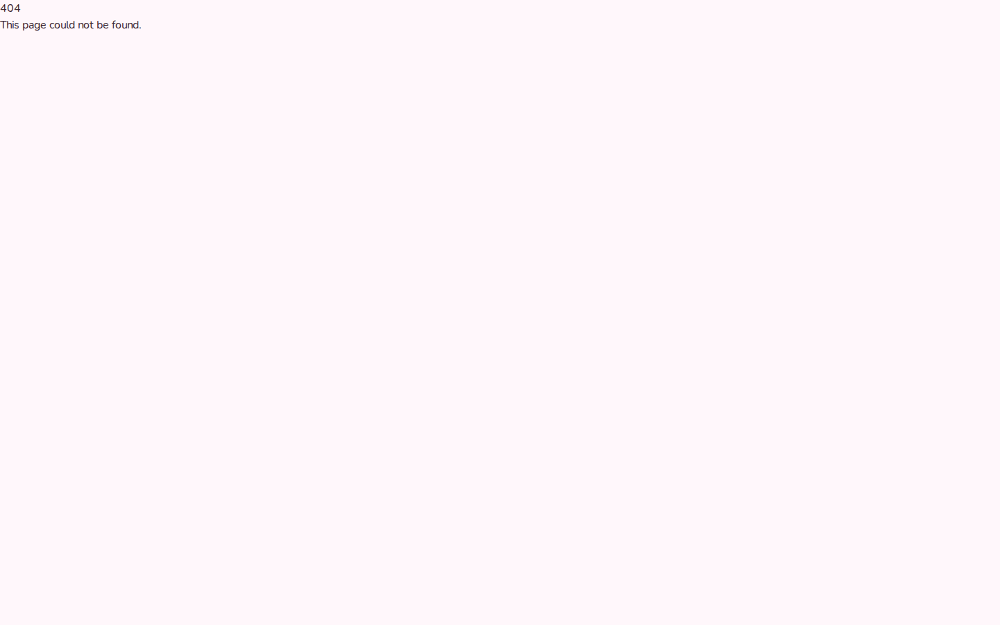
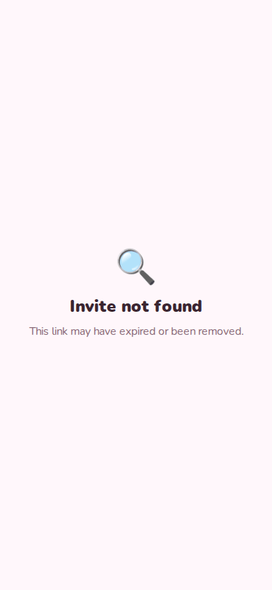

| # | Sev | Problem | Fix |
|---|---|---|---|
| 12.1 | S2 | The generic 404 is Next's default page, and it renders as two unstyled lines in the top-left corner because the CSP also blocks its inline styles. | Add a branded `src/app/not-found.tsx` and `error.tsx`. |
| 12.2 | S3 | "Invite not found" has no way forward. | Add "Make your own invite" and "Go home" links. |

## UI polish list

1. Fix the global `button, input { font: inherit; }` override so every button gets its intended size and weight (`src/app/globals.css`).
2. Raise contrast: `#c0a0b0` helper text is 2.2:1 on the background and used in about 106 places; white on the primary pink is 2.4:1; white on lavender `#c7a6ff` is 2.0:1. Darken these tokens.
3. Replace raw hex colors (`text-[#8a6a78]` appears 132 times) with named Tailwind theme tokens so contrast and a future dark mode can be fixed in one place.
4. There is no dark mode; the app ignores `prefers-color-scheme`. Not urgent for the brand, but tokens make it cheap later.
5. Standardize button casing (sentence case) and button heights across the wizard, dashboard and planner.
6. Make the desktop layouts use the space: the dashboard, settings and invite flows are a 480px column in a 1440px window with nothing else on screen.
7. Add accessible names to icon and emoji buttons (reorder arrows, verdicts, progress hearts) and associate all form labels.
8. Branded 404 and error pages.
9. Consistent product name, favicon and OG image text.
10. Remove developer-facing UI from user screens (API call counters in the planner, API usage in settings).

## Engineering health

| Check | Result |
|---|---|
| `npm ci` | Works. The local `node_modules` was stale (Next 16.2.10 installed while `package.json` requires ^16.4.3) until reinstalled. |
| `npm run lint` | Passes with no warnings. |
| `tsc --noEmit` | Passes. |
| `npm test` (Vitest) | 45 files, 321 tests, all pass in about 13 seconds. |
| `npm run build` | Passes. Logs a `[QueueClient] Region not detected` warning twice at build time. |
| `npm run test:e2e` (Playwright) | 15 of 15 pass across Chromium desktop, Chromium mobile and WebKit mobile in 2.6 minutes. |
| `npm audit` | 31 findings (10 high), 11 in production dependencies (6 high: `brace-expansion`, `nanoid`, `source-map-js`, `zod` via transitive deps); all have non-breaking fixes. Five Dependabot PRs are open. |
| CI | None. No `.github/workflows`. |
| Secrets | No secrets are tracked. `.env*`, `.clerk/`, `.vercel/` and the E2E database are gitignored, and a history scan for Clerk, Resend and Google key patterns found only documented placeholders. Keep it that way: the repo is now public. |

Gaps worth fixing:

- **The E2E suite cannot see the two worst bugs.** `layout.tsx` drops `ClerkProvider` when `PLAYWRIGHT_E2E=1`, and the tests only fail on hydration errors, not CSP violations. Add one test with Clerk enabled that loads `/login` and fails on any `securitypolicyviolation` event, and one visual check that a primary button's computed `font-weight` is 900.
- **No authenticated E2E coverage.** Sender flows (send, planner, share, post-date) are only covered by unit tests. Use `@clerk/testing` with a Clerk testing token so the full loop runs in CI.
- **CSP and inline styles.** The strict CSP is good security, but it currently breaks Clerk, Next's default pages and every SSR inline `style`. Decide deliberately: nonce for Clerk plus `style-src-attr 'unsafe-inline'` is a reasonable trade.
- **Global API budgets** (see 8.3) are a scalability ceiling, not just a cost guard.
- **`SenderPlanningView.tsx` is 2,354 lines.** Split it into stop list, venue search, timeline, map and notify components before adding features.
- **Docs drift.** `PRODUCT_FLOW.md` says Google-only sign-in, the README says magic link plus Google, and Clerk actually offers email plus password. `PRODUCT_PLAN.md` still describes Supabase. `OUTSTANDING.md` says "no known outstanding code findings".
- **Repo hygiene.** Root contains a `tsconfig.tsbuildinfo` (ignored) and an unused `supabase/` folder; `.env.local` still contains an unused `YELP_API_KEY`.
- **CI to add first:** lint, typecheck, Vitest, build, Playwright Chromium, `npm audit --omit=dev --audit-level=high`, and a secret scan (gitleaks) on every pull request.

## Market and differentiation

The space has two crowded halves and an empty middle.

**"Will you go out with me" pages with a runaway No button** are everywhere: Bondlyfe, Just Say Yes to Me, dozens of Val Town and v0 templates, and countless TikTok-driven one-off sites.
They are free, viral and shallow: the experience ends at "Yes".

**AI date planners** are also multiplying: Dua (AI date planner for couples, iOS), BlindfoldDate (mystery dates revealed on the day, from $0.99), Best Date Ever (local spots with booking links), Dates - Date Night Ideas (itinerary generator with PDF export), and dateplanner.ai.
They are single-player tools: one person plans, the other is told.

**Cutely Ask Me's real differentiator is the handoff between the two.**
The recipient picks the vibe, the sender does the real planning, and both keep the memory.
Nobody else in either category turns a cute ask into a real, routed, calendar-ready itinerary and then into a keepsake.
What would make it stand out:

1. **Lead with the ask, deliver the plan.** The dodging-No page is the viral hook; the itinerary is what makes the recipient say "wait, they actually planned this".
2. **The keepsake card is the share loop.** Make it render to an image for Instagram stories and include a subtle "made with Cutely Ask Me" link.
3. **Low-effort mode for senders.** One-tap "plan it for me" that picks a sensible venue per stop, so the sender is not dropped into a power tool.
4. **Couples retention.** "Places you loved" and Reminisce mode are a genuine reason to come back monthly, which none of the novelty pages have.

Sources: [Bondlyfe](https://hunted.space/product/bondlyfe), [Just Say Yes to Me](https://peerpush.com/p/just-say-yes-to-me), [Val Town valentine template](https://www.val.town/embed/x/Chadi/valentine/README.md), [Dua: AI Date Planner Couples](https://mwm.ai/apps/dua-ai-date-planner-couples/6769268265), [BlindfoldDate](https://peerpush.com/p/blindfolddate), [Best Date Ever](https://apps.apple.com/us/app/-/id6748460083), [Dates - Date Night Ideas](https://appgoblin.info/apps/6762744327), [dateplanner.ai](https://www.toolmage.com/en/tool/dateplannerai/), [Cupla 2026 roundup](https://cupla.app/blog/best-date-night-apps-couples-2026/).

## Verdict

**Yes, it deserves an n8builds.dev/upcoming card and a landing page with a waitlist - but not a public "try it now" link yet.**

The idea is better than halfway decent.
The recipient experience is already the most polished, emotionally resonant thing in the codebase, the engineering foundation is unusually solid for a side project (strict security, durable notifications, 321 tests), and there is a clear gap between the novelty ask pages and the AI planners that this product fills.

It is not ready to send strangers into, because a stranger arriving today hits an unstyled sign-in page, cannot create an account by email, never receives the invite email, and (if a few people try at once) exhausts the shared Google Places quota.
A waitlist is the right shape: it captures interest while those launch blockers get fixed, and it does not depend on the app working for strangers yet.

**Minimum work before the landing page and waitlist go live:**

1. Pick the name (recommend "Cutely Ask Me") and use it on the landing page; reserve or decide on the domain (`cutelyask.me` was unregistered as of June) so the waitlist page can point at the eventual home.
2. Fix the sign-in CSP bug (S1 2.1) and the button font override (S2 4.1), because the landing page will link to the live demo and both are visible in seconds.
3. Make the name-only demo (`/invite/YourName`) an intentional, labeled demo, and embed or link it from the landing page; it is the best possible pitch and needs no account.
4. Record a 20 to 30 second screen capture of ask to wizard to plan to keepsake for the landing page.

**Minimum work before opening the waitlist to real users:** everything in the S1 list below, plus the custom domain, Resend domain verification and Clerk production instance from LAUNCH.md.

## Prioritized next steps

### P0 - before anyone outside sees it

1. Fix Clerk styling under the CSP (pass the nonce) and add a CSP-violation E2E test with Clerk enabled. (2.1)
2. Fix the unlayered `button, input { font: inherit; }` rule in `globals.css`. (4.1)
3. Fix email sign-up (real `/sign-up` route) or disable password auth in Clerk. (2.2)
4. Auto-derive the event timezone from the invite location; remove the 420-item picker from the recipient flow. (5.1)
5. Block sharing until every stop has a venue, and render a read-only "Shared" state after confirmation with real 409 messages. (8.1, 8.2)
6. Decide the CSP stance on inline style attributes and fix the floating decor and default 404. (4.2, 12.1)
7. Unify the product name across UI, metadata, manifest and emails, and update `metadataBase`. (1.2)

### P1 - before opening the waitlist

8. Buy the domain, verify Resend, move Clerk to production (LAUNCH.md steps 0 to 3).
9. Rework Places budgets: per-user quotas, lazy photos, response caching, higher console caps with billing alerts. (8.3)
10. Recipient plan view with map, addresses, navigation and calendar export. (9.1)
11. Honest send-success copy and recipient "waiting for the plan" state. (3.1, 6.2)
12. Move API usage to an owner-only admin page. (11.1)
13. Gender-neutral copy. (8.6)
14. Add CI (lint, typecheck, Vitest, build, Playwright, audit, gitleaks) and merge or close the open Dependabot PRs.
15. Authenticated Playwright coverage of the sender loop using Clerk testing tokens.

### P2 - to make it stand out

16. Real landing page with a live ask demo and a waitlist form on n8builds.dev.
17. Guided "plan it for me" mode for senders, with advanced controls tucked away. (8.4)
18. Keepsake card export to an image for social sharing.
19. Contrast and design-token pass, then optional dark mode. (UI polish 2 to 4)
20. Split `SenderPlanningView.tsx` into focused components.
21. Refresh `OUTSTANDING.md`, `PRODUCT_FLOW.md` and `PRODUCT_PLAN.md` so they match reality.
